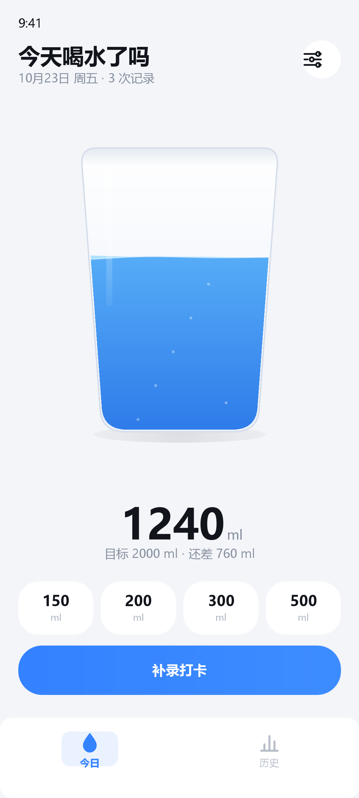
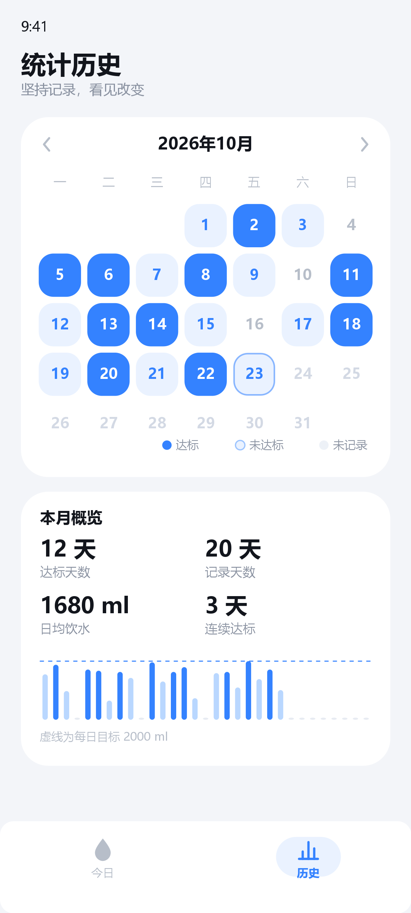
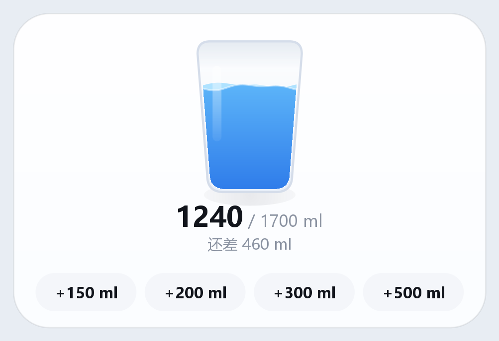

# 今天喝水了吗

一个轻量的每日饮水打卡 Android 应用。两个页面：**打卡首页**（水杯水位动效）与**统计历史**（日历三态标记 + 月概览）。

| 打卡首页 | 统计历史 | 桌面小部件 |
| --- | --- | --- |
|  |  |  |

> 上图为按本项目实际绘制参数（杯型路径、水波正弦叠加、配色、栅格尺寸）等比例渲染的设计预览，用于表达视觉与排版，非真机截图。

## 功能

- **每日目标**：可在 500–5000 ml 之间调整（步进 100 ml，另提供 1200/1500/2000/2500/3000 预设），保存后立即刷新水位与达标判定。
- **快捷打卡**：4 个胶囊按钮，点击即以当前时间记一次；记录后水位弹性上涨、水面晃动，并在提示行内嵌「撤销」（3.6 秒内可撤销，不遮挡主按钮）。
- **自定义快捷水量**：设置弹层（右上角按钮，或长按任一快捷按钮）中可分别调整 4 个按钮的水量（50–1000 ml，步进 50），默认 150 / 200 / 300 / 500 ml，保存后立即生效并持久化。
- **补录打卡**：底部弹层中选择最近 7 天中的某一天、滚轮选择时/分、步进或预设调整水量，一次写入。若选择的时间晚于当前时刻，会自动收敛为当前时间并提示。
- **日历统计**：按月查看，每天按状态着色——达标（蓝色实心）、未达标（浅蓝实心）、未记录（无底色）、未来日期（浅灰文字）；今天带描边。点击某天可查看当天每条记录并逐条删除。
- **本月概览**：达标天数、记录天数、日均饮水、连续达标天数，以及每日饮水柱状图（虚线为每日目标）。
- **桌面小部件（4×2）**：桌面上直接看今日进度，点 4 个按钮即可快捷打卡；点击杯体/数字进入 App。小部件与 App 共用同一份数据，操作后立即互相同步，跨天自动刷新。
- **我的页**：每日目标与快捷水量设置、JSON 导入导出、WebDAV 云同步、关于信息。底部导航为「今日 / 历史 / 我的」三栏。

## 构建与运行

环境要求：**JDK 17**、Android SDK Platform 34。项目自带 Gradle Wrapper（8.7），无需本机安装 Gradle。

```bash
# 本机环境变量 JAVA_HOME 指向了无效路径时，需显式指定
export JAVA_HOME="D:/Environment/Java/jdk-17.0.12"

./gradlew :app:assembleDebug
adb install -r app/build/outputs/apk/debug/drink-today-app.apk
```

`local.properties` 中的 `sdk.dir` 指向本机 SDK（`D:\Environment\sdk\android`），换机器时请修改或由 Android Studio 重新生成（该文件不入库）。

构建产物：

- `app/build/outputs/apk/debug/drink-today-app.apk`（约 3.2 MB，含调试信息）
- `app/build/outputs/apk/release/drink-today-app-release.apk`（约 **0.65 MB**，未签名，已开启 R8 混淆与资源压缩，需自行签名后安装）

## 技术方案

| 层面 | 选择 | 理由 |
| --- | --- | --- |
| 语言 / UI | Kotlin + 原生 View（无 Compose、无 Material Components） | 单 Activity 双页面，控件全部可自绘，避免引入整套 UI 运行时 |
| 视觉 | `CupView`、`CalendarView`、`BarChartView`、`WheelPicker` 四个自绘 View | 水波、日历格、柱状图、滚轮需要精细控制绘制与动效，自绘比组合控件更轻、更可控 |
| 存储 | SharedPreferences + 单个 JSON 键 | 每天几条记录，读取一次性载入内存仅数 KB；省去数据库进程与注解处理 |
| 网络 | `HttpURLConnection` + Basic Auth | 只需要 GET/PUT 一个 JSON 文件，不值得为此引入 OkHttp |
| 依赖 | `androidx.core-ktx`、`androidx.appcompat` | 仅保留必要依赖，release 包体 0.65 MB |

### 目录结构

```
app/src/main/java/com/drinktoday/
├── MainActivity.kt            页面切换、底部导航、系统栏内边距
├── data/
│   ├── DrinkStore.kt          记录/目标读写、月汇总、连续达标、导入导出
│   ├── WebDavConfig.kt        WebDAV 服务器/账号/上次同步时间
│   ├── WebDavClient.kt        极简 WebDAV 客户端（GET/PUT）
│   └── Models.kt              DrinkRecord / DaySummary / DayState / ImportResult
├── ui/
│   ├── CupView.kt             玻璃杯、双频水波、气泡、水位动画、帧循环
│   ├── CalendarView.kt        月历三态绘制与点击命中
│   ├── BarChartView.kt        每日水量柱状图
│   ├── WheelPicker.kt         惯性滚动 + 吸附的时分滚轮
│   ├── TodayPage.kt           首页逻辑
│   ├── HistoryPage.kt         历史页逻辑
│   ├── BaseSheet.kt           底部弹层基类（全屏透明窗口 + 贴底卡片）
│   ├── AddRecordSheet.kt      补录
│   ├── SettingsSheet.kt       目标与快捷水量设置
│   ├── DayDetailSheet.kt      单日详情与删除
│   ├── TouchFx.kt             统一按压反馈
│   ├── Pills.kt               胶囊标签
│   ├── MePage.kt              「我的」页：设置、导入导出、同步、关于
│   ├── WebDavSheet.kt         WebDAV 账号配置弹层
│   ├── Palette.kt             自绘用配色
│   └── widget/
│       ├── DrinkWidgetProvider.kt  小部件更新、快捷打卡广播、跨天刷新
│       └── WidgetRenderer.kt       构建 RemoteViews（离屏渲染水杯位图）
└── util/                      dp 换算、日期文案
```

## 数据与同步

### 导入 / 导出

- **导出**：`我的 → 导出数据`，通过系统文件选择器（SAF）生成 `drink-today-backup-yyyyMMdd.json`，内容与本地存储格式完全一致。
- **导入**：`我的 → 导入数据`，读取 JSON 后**合并**到本地：按记录 `id` 去重，不删除已有数据；同时采用文件中的目标与快捷水量（用于恢复备份）。
- 不涉及存储权限：走 SAF，用户自行选择落点。

### WebDAV 云同步

- 支持坚果云、Nextcloud 等标准 WebDAV 服务。远端固定文件：`drink-today-backup.json`。
- 配置：`我的 → WebDAV 账号`，填写服务器地址（必须 `https://`）、账号、**应用专用密码**，可先「测试连接」再保存。
  - 坚果云示例：地址 `https://dav.jianguoyun.com/dav/`，密码在「账户信息 → 安全选项 → 添加应用」中生成。
- 同步流程（`我的 → 立即同步`）：下载云端 → 按 `id` 合并进本地（**不覆盖本机目标与快捷水量**）→ 上传合并后的完整数据。
- 并发与线程：网络 I/O 在后台线程；JSON 合并与设置写入回到主线程，避免与 UI 同时读写 `DrinkStore`。

### 已知限制

- 同步为**手动触发**，没有后台定时任务（避免常驻唤醒）。
- 冲突策略是「记录取并集」，不处理同一条记录在两台设备被改成不同水量（当前实现里记录不可编辑）。
- WebDAV 密码以明文存放在应用私有 `SharedPreferences`，未做加密；建议使用应用专用密码。

## 桌面小部件

- 采用标准 AppWidget（`RemoteViews`），HyperOS / MIUI / 原生桌面均可在「添加小部件」中找到「喝水打卡」。
- **水杯与 App 同源**：RemoteViews 不能承载自绘 View，这里把真实的 `CupView` 离屏 `measure → layout → draw(Canvas)` 渲染成 Bitmap 再交给 `ImageView`，因此杯型、水位、配色永远与 App 一致，不会出现第二套画法。
- **左右分栏**：左侧水杯作为主体，杯下「已喝 / 目标」同字号（17sp，靠颜色区分层级），不再显示提示行；右侧 2×2 快捷按钮（数字 17sp + 单位 11sp），行高随卡片等分，拉伸时按钮一起长高。
- **按实例尺寸渲染**：读取 `OPTION_APPWIDGET_MIN_WIDTH/MIN_HEIGHT` 推算左栏杯区宽高，位图按实际尺寸生成，拉伸或换格子时不发虚；小部件为白底卡片，因此关闭了杯底投影。
- 4 个快捷按钮复用用户在设置里的快捷水量，点击后写入 `DrinkStore` 并立即刷新小部件（附带一次 Toast 反馈）。
- 同步策略：App 内数据变化（`onStop`）、小部件按钮点击、`ACTION_DATE_CHANGED` / `TIME_SET` / `TIMEZONE_CHANGED` 以及 30 分钟系统周期刷新。
- 受 RemoteViews 限制，小部件是**静态一帧**：没有水位上涨与水波动画（动画只存在于 App 内）。

## 动效设计

- **水位**：`ValueAnimator` 900 ms + `OvershootInterpolator(0.5)`，水面先略微涌起再回落；下降时改为 420 ms 减速，避免"抽空"感。
- **水波**：两组不同频率、不同相位的正弦叠加（主波 + 后层波），相位随时间推进；记录瞬间 `slosh` 置 1，波幅与波速同时提升，约 1.5 s 内线性衰减回静息状态。
- **帧循环**：`Choreographer` 按帧推进相位。仅在「已附加 + 可见 + 页面在前台 + 有水」时运行；杯子为空或切到历史页立即移除回调，避免后台无效绘制。
- **页面切换**：淡入 + 12 dp 上移（260 ms，`PathInterpolator(0.2,0.8,0.2,1)`），旧页 150 ms 淡出；底部导航指示器 280 ms 平移，图标与文字同步换色。
- **按压反馈**：所有可点击元素按下缩至 0.955，松手以 `OvershootInterpolator(2.2)` 回弹。

## 性能与内存控制

- 无 Bitmap、无离屏缓存、无图片资源（图标均为 VectorDrawable）。
- `CupView.onDraw` 复用 `Path` / `Paint` / `RectF`，内部不产生新对象；单帧约 90 个路径采样点 + 7 个气泡。
- 空杯状态不启动帧循环；Activity `onPause` 与页面切换都会暂停，恢复时接续。
- 数据写入为整体 JSON 覆盖，记录规模小（每天数条，十年也就数百 KB），`apply()` 异步落盘不阻塞主线程。
- release 开启 R8 与 `shrinkResources`，APK 约 0.65 MB。

## 数据模型

```json
{
  "goal": 2000,
  "lastAmount": 200,
  "quick": [150, 200, 300, 500],
  "days": {
    "20718": [
      { "id": 1759..., "t": 1759..., "a": 200 }
    ]
  }
}
```

- 键为 `epochDay`（1970-01-01 起的天数），避免时区/夏令时造成的跨日错乱；时间戳保留到毫秒用于展示时/分。
- 单日记录按时间升序保存；`quick` 为首页 4 个快捷按钮的水量。读取时若 JSON 损坏则静默降级为空数据，不阻塞启动。
- 快捷按钮用单个 `TextView` 承载「数值 + 单位」两行（`RelativeSizeSpan` 缩小单位），并开启 autoSize，避免机型字体放大时数字被裁切。

## 已知取舍

- **目标变更会重算历史达标状态**：不保存每日目标快照，历史达标以当前目标判定。对单用户小工具而言，这样更符合"我现在的标准"。
- **补录范围为最近 7 天**：覆盖"忘记打卡"的典型场景，避免弹层里塞入完整的日期选择器。
- **仅浅色主题、仅竖屏**：与 HyperOS 天气/健康类应用的浅色轻量风格保持一致；如需深色模式，可在 `Palette` 与 `colors.xml` 增加一套夜间取值。
- **同步无自动合并调度**：见「数据与同步 → 已知限制」。
- **无提醒通知、无云同步**：定位为纯本地轻量工具。

## 版本记录

```
git log --oneline
```

- `chore` 工程骨架与数据层
- `feat` 水杯视图与水波动效
- `feat` 打卡首页、历史统计页与弹层
- `polish` 杯型与预览校准、Lint 清理
- `fix` 导航顺序修正为「今日 / 历史 / 我的」，我的页去掉技术说明（v1.2.1）
- `feat` 「我的」页：设置、JSON 导入导出、WebDAV 同步、关于（v1.2.0）
- `fix` 快捷按钮数字裁切，快捷水量改为可自定义（v1.0.1）
- `feat` 桌面小部件：进度 + 快捷打卡（v1.1.0）
